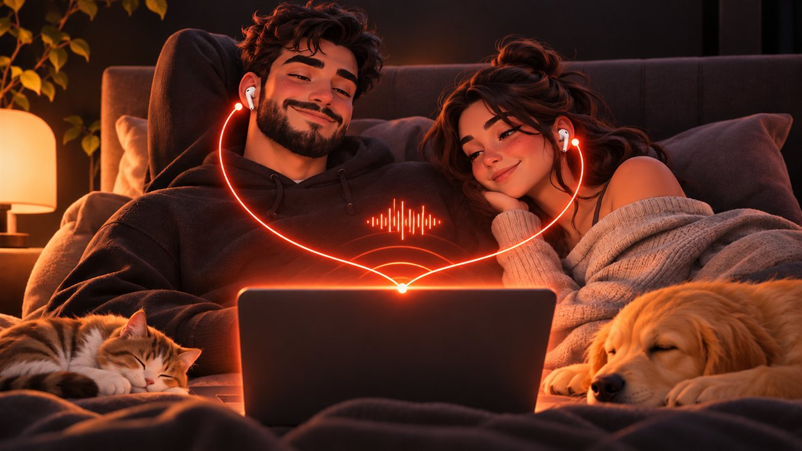
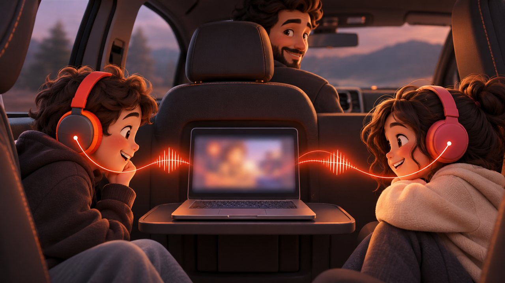

<p align="center"></p>

<h1 align="center">Earmates: one laptop, several headphones</h1>

<p align="center">Play the same audio on several Bluetooth headphones, earbuds and speakers at once, on Mac and Windows. Connect two (or more) AirPods, headphones or speakers to one computer and everyone hears the same film, show or music.</p>

<p align="center"><b>Made for partners, friends and families:</b> one laptop, everyone in their own headphones, each at their own volume.</p>

<p align="center">
  <a href="https://github.com/ck98-01/earmates-app/releases/latest/download/Earmates-mac.zip"><b>⬇ Download for Mac</b></a>
  &nbsp;·&nbsp;
  <a href="https://github.com/ck98-01/earmates-app/releases/latest/download/Earmates-windows.zip"><b>⬇ Download for Windows</b></a>
</p>

<p align="center">Free. Works without internet. Collects nothing. · <a href="https://ck98-01.github.io/earmates-app/">Website</a> · <a href="#support-earmates">Support</a></p>

---

## Who it's for

### Partners
Watch a film in bed together, each with your own earbuds, without waking anyone.



### Friends
Share a show, a match or a playlist on a train, a plane or in a café, with nobody's sound leaking out.


### Families on the road
Keep the kids happy on a road trip with one laptop and several headphones.



### Family movie night
Give a grandparent who hears less their own louder volume, while everyone else stays comfortable.


**And anyone** who wants the laptop speakers and headphones playing together, for example a small gathering where some people want headphones.

---

## Mac

**Needs:** macOS 13 Ventura or newer (any Mac from about 2017 on, Apple Silicon or Intel).

### Install (about 2 minutes, once)

1. **[Download Earmates for Mac](https://github.com/ck98-01/earmates-app/releases/latest/download/Earmates-mac.zip).**
2. Open your **Downloads** folder and double-click **Earmates-mac.zip**. **Earmates** appears next to it.
3. Drag **Earmates** into your **Applications** folder.
4. Double-click **Earmates** in Applications. The Mac will say it **"can't check Earmates for malicious software"** (or *"Apple could not verify…"*). That's expected: Earmates isn't from the App Store. Click **Done** (not *Move to Bin*).
5. Open **System Settings → Privacy & Security**, scroll down to the message about Earmates, and click **Open Anyway**. Enter your Mac password if asked, then click **Open Anyway** again.

Earmates opens. From now on it opens normally, like any other app.

**Connect your headphones first:** open **System Settings → Bluetooth**, put the headphones in pairing mode, and click **Connect** next to them. Wired headphones just need plugging in.

### Using it

1. **Play some music** on your Mac as you normally would.
2. **Open Earmates.** Every headphone and speaker the Mac knows about appears as a card: things you connected under **Connected devices**, and the Mac's own speakers under **On this Mac**.
3. **Turn the switch on** (top right of a card) for every device that should play.
   - **Not sure which card is which headphone?** Click **Test** on a card. Only that device plays a short chime, at its volume, so each person can check their level too.
4. Click **Share audio** (top right). The pill next to it says **Sharing to 3** (or however many) with a green dot.
5. Everyone now hears whatever the Mac plays: films, music, any app.
6. To stop, click **Stop sharing**, or quit Earmates. Your Mac's sound goes back to where it was before.

Earmates remembers which switches were on for next time.

### Something's not right?

#### 🔊 "The volume keys don't do anything"

That's normal while sharing: macOS turns off the volume keys for shared sound. Use the **Volume** slider on each card instead. Turn on **Link volumes** to move all the switched-on devices together.

#### 🔇 "I don't hear anything on one headphone"

1. Is its **switch on**, and does its card say **Sharing**?
2. Click **Test** on its card. No chime? Check it's connected in **System Settings → Bluetooth**, and that its own volume is up.
3. Card says **"Use its own buttons"** under Volume? That device has no volume control on the Mac. Use the buttons on the device itself.

#### 🎧 "One Bluetooth headphone sounds tinny or muffled"

Its card will say **"Sounds bad? An app is using this headset's microphone."** While any app (a video call, Siri, dictation) uses a Bluetooth headset's microphone, the headset switches to phone-call quality. Close that app, or pick another microphone in **System Settings → Sound → Input**.

#### ⏱️ "One headphone plays slightly later than the others"

Bluetooth headphones each have their own small delay (often a tenth to a third of a second), and it differs between models. Wired headphones and the Mac's speakers are almost instant. For films, everyone wearing the **same kind** of headphones works best.

#### 📢 "The sound crackles or cuts out"

1. **Move closer.** Keep Bluetooth headphones within about 3 metres of the Mac.
2. **Use fewer Bluetooth headphones.** About 3 at once works best. Earmates shows a yellow note above that.
3. **Use 5 GHz Wi-Fi** if your router has it (often a network with *5G* in its name).

#### 🔌 "A headphone disconnected while sharing"

The others keep playing. Its card says **Disconnected**. Connect it again and it rejoins by itself.

#### 🆘 "My Mac's sound is stuck somewhere strange"

Open Earmates and close it again: it puts the sound back. Or choose your output in **System Settings → Sound → Output**.

---

## Windows

**Needs:** Windows 10 or 11 (64-bit).

### Install (about 2 minutes, once)

1. **[Download Earmates for Windows](https://github.com/ck98-01/earmates-app/releases/latest/download/Earmates-windows.zip).**
2. Open your **Downloads** folder, right-click **Earmates-windows.zip** → **Extract All…** → **Extract**.
3. Move **Earmates.exe** somewhere you'll find it again, for example your **Desktop** or **Documents**.
4. Double-click **Earmates.exe**. Windows may show **"Windows protected your PC"**. That's expected for apps that aren't from the Microsoft Store: click **More info**, then **Run anyway**.

Tip: right-click **Earmates.exe** → **Show more options** → **Pin to Start** so it's in your Start menu.

**Connect your headphones first:** open **Settings → Bluetooth & devices → Add device**.


### Using it

#### What you need

- A Windows 10 or 11 laptop or PC with Earmates downloaded (see *Install* above).
- The headphones or speakers you want to use, **already connected to Windows**. To connect Bluetooth headphones: open **Settings → Bluetooth & devices → Add device**.

#### First time (about 5 minutes)

1. **Play some music** on your laptop as you normally would.
2. **Open Earmates.**
3. Leave **Audio source** on **Automatic: follow Windows**. The app copies from wherever Windows is playing, and follows along if you switch output.
   - The **green bar** on that device's card should move with the music.
4. On every other device that should play the music, **turn the switch on** (top right of its card).
   - **Not sure which card is which headphone?** Click **Test** on a card. That device plays a short chime at the card's **Volume**, so each person can also check their level is comfortable before you start.
5. Click **Share audio** (top right of the window). The button turns red, which means sharing is on.
6. Everyone should now hear the music. If some devices play slightly earlier than others, see *"The devices aren't in sync"* below.

#### Every day after that

1. Connect your headphones to Windows as usual.
2. Open Earmates and click **Share audio**. It remembers your choices from last time.
3. To stop, click **Stop sharing** (the red button) or close the app.

---

### Something's not right? Find your problem below

#### 🔇 "I don't hear anything on the extra headphones"

Check these in order:

1. **Is the button at the top right red** (*Stop sharing*)? If it says *Share audio*, click it.
2. **Is the switch on** for that headphone's card?
3. **Is a yellow box showing** under *Audio source*? Click **Use Automatic**.
4. **Is the green bar moving** on the source card? If not, check the music is actually playing, and that **Audio source** is set to **Automatic: follow Windows**.
5. **Is the headphone's volume up?** Check the **Volume** slider on its card, and the headphone's own buttons.

#### ⚠️ A card says "Could not open… can't play while another Bluetooth device is playing"

Your laptop is only allowing one Bluetooth headphone at a time. This is common on laptops with Intel chips, and it can be fixed once:

1. Open **Settings → Bluetooth & devices**, find **"Use LE Audio when available"**, and turn it **Off**.
   - Don't see it? Open **Settings → Windows Update → Advanced options → Optional updates**, install the **Intel Bluetooth** update, restart, and look again.
2. In Earmates, turn on **Classic Bluetooth mode** (in the Bluetooth box at the top). Click **Yes** when Windows asks for permission.
3. **Remove and pair each headphone again:** in **Settings → Bluetooth & devices**, click **⋯** next to it → **Remove device**, then **Add device** and pair it again.
4. In Earmates, click the **refresh** button (↻) and try again.

Quick workaround while you don't have time for this: turn **off** one of the Bluetooth headphones in Earmates.

#### 🎧 "My earbuds won't connect" or show "Couldn't connect"

1. Put the earbuds **in their case**, close the lid, wait **5 seconds**, open it, and try again.
2. Make sure they aren't connected to **your phone** at the same time. Turn your phone's Bluetooth off for a minute.
3. Still not working? **Remove and pair them again:** **Settings → Bluetooth & devices → ⋯ → Remove device**, then **Add device**.

#### 📢 "The sound crackles, pops or cuts out"

1. **Wait about a minute.** Earmates adjusts itself after each glitch. Each card shows *"cushion … ms · … dropouts"*: once the dropout number stops going up, it has settled.
2. **Move closer.** Keep Bluetooth headphones within about 3 metres of the laptop.
3. **Use 5 GHz Wi-Fi** if your router has it (often a network with *5G* in its name). Normal Wi-Fi and Bluetooth share the same airwaves and get in each other's way.
4. **Use fewer Bluetooth headphones.** About 3 at once works best.
5. **Pause big downloads and video calls** while sharing.

#### ⏱️ "The devices aren't in sync" (echo, or one plays slightly earlier)

1. Click **Test sync** (above the device cards). You'll hear a tick every second.
2. Find the device whose tick comes **first**.
3. Slowly drag its **Delay** slider to the right until its tick lands together with the others.
4. Repeat for any other early device, then click **Stop test**.

The app remembers these delays for next time.

#### ❓ "I don't know which card is which headphone"

Click **Test** on a card. Only that device plays a short chime. Ask each person "did you hear it?" to match names to people.

#### 🔍 "My headphones aren't in the list"

1. Check they're **connected** in **Settings → Bluetooth & devices** (it should say *Connected*).
2. In Earmates, click the **refresh** button (↻) next to *Audio source*.

#### 🔊 "One device is too loud or too quiet"

Use the **Volume** slider on that device's card. Turn on **Link volumes** if you want all sliders to move together.

#### 🛡️ "Windows asks for permission (a Yes/No box)"

That only happens when you switch **Classic Bluetooth mode** on or off. Click **Yes**. It's safe, and you can switch it back the same way.

#### ↩️ "Something stopped working after I changed a setting"

1. In Earmates, turn **Classic Bluetooth mode** **off** (click **Yes**), then remove and pair your headphones again.
2. Still broken? **Restart the laptop.**
3. Still broken? Use **System Restore** (search *"Create a restore point"* in the Start menu → **System Restore**) and pick the point from before the change.

#### 🆘 Nothing above helped

1. Close Earmates and open it again.
2. Restart the laptop.
3. Write down what the device cards say (or take a screenshot) and ask for help with that.

---

## Frequently asked questions

### Can I connect two Bluetooth headphones to one Mac or Windows laptop?
Yes, that's exactly what Earmates does. Both macOS and Windows normally play sound on only one output at a time. Earmates plays it on all the headphones and speakers you switch on, each at its own volume.

### Does it work with AirPods, Sony, Bose, Beats or Samsung earbuds?
Yes. Any headphones or speakers the computer can play sound on work: Bluetooth (AirPods, Sony, Bose, Beats, Samsung Galaxy Buds, JBL…), wired, USB, the headphone jack, and monitors or TVs over HDMI.

### How many headphones can I use at once?
As many as the computer can connect. With Bluetooth, about 3 at once works best; more can crackle because they share one radio. Wired headphones don't count toward that.

### Will the sound be in sync?
Wired headphones and the laptop's speakers are nearly instant. Bluetooth headphones each have their own small delay, and it differs by model. On Windows you can line them up with the **Delay** sliders and **Test sync**. On a Mac, the same kind of headphones for everyone works best.

### Does it work for Netflix, YouTube, Spotify and games?
Yes. Earmates shares everything the computer plays, from any app or website.

### Does it work on iPhone or iPad?
No. Apple doesn't allow it there. iPhone and iPad have their own **Share Audio** for two sets of AirPods or Beats: open Control Center, tap the AirPlay icon, then **Share Audio**.

### Is it free? Is it safe?
Yes and yes. It's free, works without internet, and collects nothing. Windows and the Mac show a warning the first time only because Earmates isn't from the App Store or Microsoft Store; the install steps above show how to open it.

## Updating

Download again from the links at the top and replace the old app. Your settings are kept.

## Support Earmates

Earmates is free, with no ads and no subscriptions. If it made a film night or a long trip better, a small tip helps keep it updated.

**USDT on the Tron network (TRC-20):**

```
TTAB8mi1sPNm5gCgGcBWSxf61abUnPNtNJ
```


⚠️ Send only **USDT** on the **Tron (TRC-20)** network. Other coins, or USDT on another network, can't be recovered.

## Questions or problems?

[Open an issue](https://github.com/ck98-01/earmates-app/issues) and say what you see (a screenshot of the Earmates window helps a lot).
